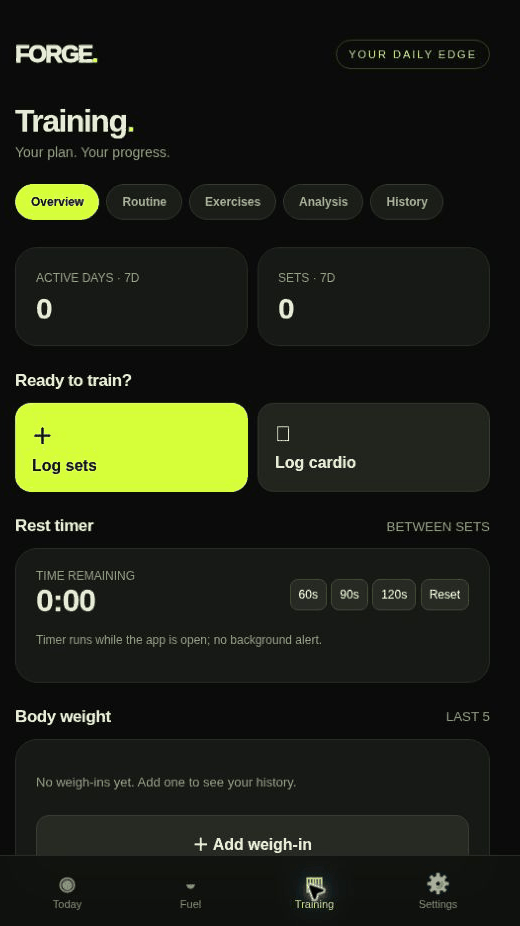
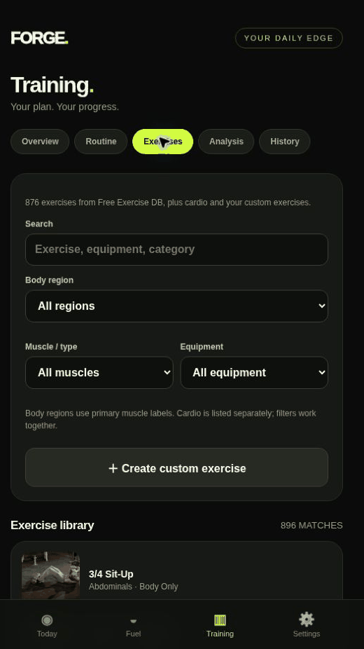
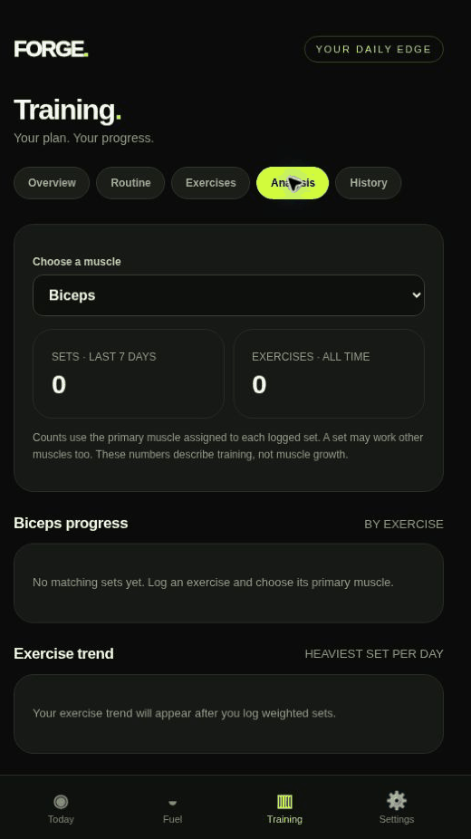

# FORGE

**Your training. Your fuel. Your progress.**

FORGE is a personal fitness tracker designed for iPhone. It combines a flexible workout planner, exercise library, progress analysis, food log, and calorie and macro planner in a dark, mobile-first app. It is a progressive web app (PWA), hosted as a static website, so you can add it to your Home Screen without an App Store subscription.

**[Open FORGE](https://mobiiin.github.io/mobin_gym_app/)** · [Browse the affirmation and quotation bank](quotes.txt)

## Inside the app

| Today | Training |
|:---:|:---:|
|  |  |
| Exercise library | Muscle analysis |
|  |  |

Screenshots show an empty demonstration state; your own entries appear after you start logging.

- **Today:** Daily food and training summaries, a random affirmation, quick logging, and a shareable text preview. You choose which details to include before sharing.
- **Training:** Log sets and cardio, track body weight, use a rest timer, and explore the overview, routine, exercise library, analysis, and history tabs.
- **Routines:** Create and switch between routines, add or remove training days and exercises, reorder or move exercises, and set optional targets and notes. The starting template uses the owner's five-day split, but you can build a different schedule.
- **Exercise library:** Browse 876 exercises from Free Exercise DB plus additional cardio activities and your own custom exercises. Filter by body region, muscle, or equipment. Exercise reference photos require an internet connection.
- **Analysis:** Inspect training history by assigned primary muscle, including set counts and weighted exercise trends. These describe logged training, not measured muscle growth.
- **Fuel and goals:** Log food and macros manually. The optional calorie and macro planner estimates a starting target using your profile, activity level, weight goal, and preferences; review the result before applying it.
- **Inspiration:** The local [affirmation bank](quotes.txt) contains 1,500 original FORGE messages, including affirmations about relationships, self-worth, and mutual respect. Many messages are composed from combinations of original phrases. The refresh button chooses another message.

## Install on iPhone

1. Open [FORGE](https://mobiiin.github.io/mobin_gym_app/) in Safari.
2. Tap **Share** → **Add to Home Screen**. Choose **Open as Web App** if offered, then tap **Add**.
3. Launch FORGE from the Home Screen. The app shell and core data files are cached for offline use after a successful first load.

## Your data and backups

Workout history, meals, routines, settings, and profile information are stored locally in the app's browser storage on that device. There is no account, backend, or automatic cloud sync. Export a JSON backup from **Settings → Your data** regularly, especially before changing devices or clearing browser/app data. Importing a backup replaces the current entries and targets. Your personal logs are not stored in this repository.

Sharing is optional: the Today button shows a preview and lets you select what to include. The device share sheet or copy action is used only when you choose to share.

## Development

The React migration is **incremental**. React owns the navigation, Today, Fuel, and the Training overview, analysis, and history screens using small components; the routine builder, exercise library, settings, and dialogs still run on the existing JavaScript implementation. The shared storage format and existing event handlers are retained so existing data continues to work. This is a static app with no build step or server requirement.

```text
index.html                 App shell and script loading order
src/components/today.js    React Today screen and reusable UI components
src/components/fuel.js     React food history screen
src/components/training-overview.js  React training overview and tabs
src/components/training-details.js   React analysis and history screens
src/components/navigation.js         React bottom navigation
src/legacy/core.js         Existing storage, navigation, and entry handling
src/legacy/workout.js      Workout logging and initial plan
src/legacy/training-v16.js Training routines, library, and cardio actions
src/legacy/training.js     Previous script retained for cached older app shells
src/legacy/routine.js      Routine editor
src/legacy/library.js      Exercise filtering and reference photos
src/legacy/nutrition-v16.js Affirmations, nutrition planner, and React bridge
src/legacy/nutrition-v14.js Previous bridge retained for cached older app shells
src/legacy/nutrition.js     Previous bridge retained for cached older app shells
src/legacy/sharing.js      Share preview, zoom handling, and startup
src/styles-v15.css         Shared app styles and fixed navigation stacking
src/styles.css             Previous stylesheet retained for cached older app shells
vendor/                    Locally hosted React 18.2.0 and React DOM (MIT)
quotes.txt                 One JSON object per line; original FORGE affirmations
sw.js                      Offline app shell cache
```

Serve from the repository root instead of opening `index.html` directly:

```sh
python3 -m http.server 8000
# Open http://localhost:8000
```

Run the dependency-free smoke check with Node.js:

```sh
node tests/modular.cjs
```

The static site can be deployed from the repository root on GitHub Pages. The service worker caches the scripts, style sheet, and data files; increment its cache name when changing cached assets. React's production files are vendored locally so the core app does not depend on a third-party CDN. Further screens can move into React incrementally; avoid running React and legacy rendering against the same DOM subtree.

## Sources and limitations

The exercise catalogue adapts [Free Exercise DB](https://github.com/yuhonas/free-exercise-db), distributed under the Unlicense; see [EXERCISE_DATA_LICENSE.txt](EXERCISE_DATA_LICENSE.txt). Muscle labels are approximate. Some exercise images are loaded from the internet.

The nutrition planner uses the [Mifflin–St Jeor equations](https://pubmed.ncbi.nlm.nih.gov/2305711/) and an activity multiplier. It approximates requested weight change using 7,700 kcal/kg; real changes are not linear. Default protein targets are 1.8 g/kg for maintenance, 2.0 g/kg for a bulk, and 2.2 g/kg for a cut, with adjustable protein and fat preferences. Carbohydrates fill remaining calories. These are starting estimates, not guarantees or medical advice.

Research includes [Morton et al. on protein and resistance training](https://pubmed.ncbi.nlm.nih.gov/28698222/), [Longland et al. on protein during a deficit](https://pubmed.ncbi.nlm.nih.gov/26817506/), and [Helms et al. on surplus size](https://pubmed.ncbi.nlm.nih.gov/37914977/). Individual needs vary, and the planner does not predict exactly how much weight change will be muscle or fat.
